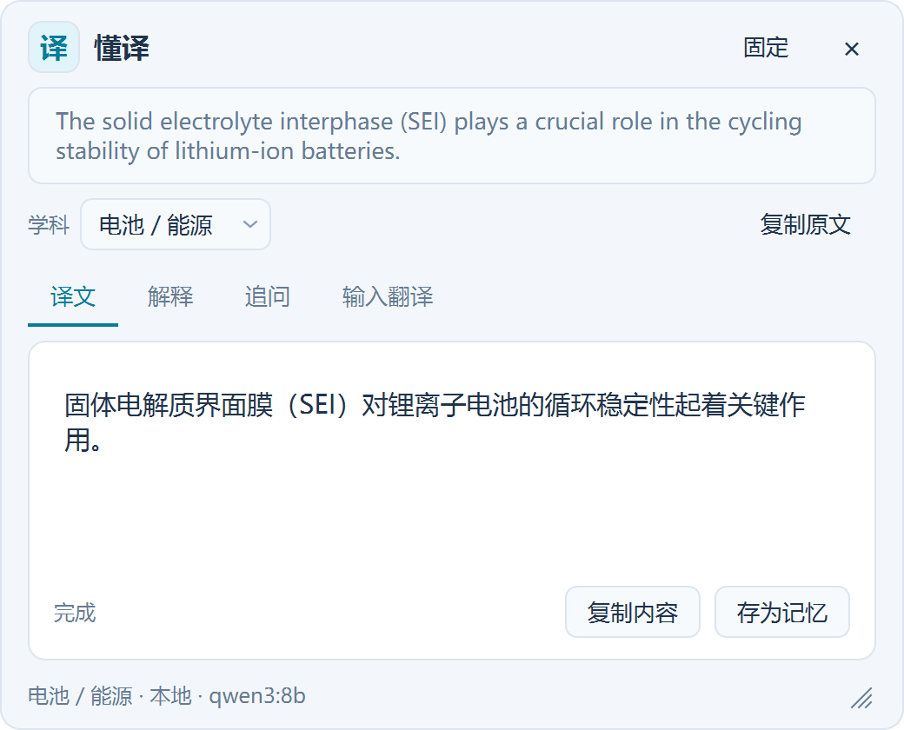

<div align="center">


> 📌 这是 **Python 原版**（v0.1.x，源码位于本仓库根目录）的说明文档。
> **Rust / Tauri 重制版（主推）**见 [仓库主页 README](README.md) 与 [`dongyi-rs/`](dongyi-rs/)。
>
> 两个版本共用 `%APPDATA%\dongyi\` 数据目录（配置 / 术语表 / 翻译记忆 / 知识库索引），可交替使用。


# 鎳傝瘧 路 dongyi

**瓒婃潵瓒婃噦浣犵殑缈昏瘧銆?*

**Windows 鍒掕瘝缈昏瘧宸ュ叿锛屾敮鎸佹湰鍦板拰浜戠妯″瀷锛涘绉戝垏鎹€佸己鍒舵湳璇〃銆佷釜浜虹煡璇嗗簱涓庣炕璇戣蹇嗭紝璁╁畠瓒婄敤瓒婃噦浣犵殑涓撲笟棰嗗煙銆?*

Domain-aware text-selection translation for Windows, powered by local Ollama or OpenAI-compatible APIs, with enforced glossaries, personal knowledge retrieval (RAG), and translation memory.

[](https://github.com/SyFu96/dongyi/actions/workflows/ci.yml)
[](https://github.com/SyFu96/dongyi/releases/latest)


[涓嬭浇 Windows 鐗圿(https://github.com/SyFu96/dongyi/releases/latest) 路 [蹇€熷紑濮媇(#蹇€熷紑濮? 路 [棰嗗煙閫傞厤](docs/DOMAINS.md) 路 [鍙嶉闂](https://github.com/SyFu96/dongyi/issues)

---

### 馃殌 Rust / Tauri 閲嶅埗鐗堝凡鍙戝竷

鍗曟枃浠躲€佹洿灏忔洿蹇細涓荤▼搴?**6.7 MiB**銆佸畨瑁呭寘 **2.4 MiB**銆佸喎鍚姩鍒板氨缁?**~0.7 s**銆佺ǔ鎬佸唴瀛?**~33 MB**锛?UI 鎸?ArtCraft Launcher 椋庡叏鏂伴噸鍋氾紙绾哥櫧搴?+ 缁嗙嚎鏍呮牸 + 缂栧彿鑹插潡锛夈€?*鏁版嵁鐩綍涓?Python 鐗堜簰閫?*鈥斺€?`%APPDATA%\dongyi\` 鐨勯厤缃?/ 鏈琛?/ 缈昏瘧璁板繂 / 鐭ヨ瘑搴撶储寮曚袱鐗堝彲鐩存帴鍏辩敤銆佷氦鏇夸娇鐢ㄣ€?
> 婧愮爜涓庤鏄庯細[`dongyi-rs/`](dongyi-rs/README.md) 路
> 涓嬭浇锛歔Releases 路 rust-v0.1.0](https://github.com/SyFu96/dongyi/releases/tag/rust-v0.1.0)


---


*10 绉掓紨绀猴紙Python 鐗堢晫闈級锛氬垝閫?Battery pack 鈫?瀛︾銆岀數姹?鑳芥簮銆嶅己鍒舵湳璇瘧鏂?鈫?涓€閿В閲娿€?

</div>

> 鍙戝竷鍖?`dongyi-v0.1.1` 涓?*棣栦釜浠ャ€屾噦璇戙€嶅彂甯冪殑鍔熻兘瀹屾暣鐗?*锛涙鍓?`huayi-v0.1.0` 涓烘敼鍚嶅墠鐨勫巻鍙插寘锛屼笉鍚鍩熼€傞厤銆傚湪鏀寔鍙栬瘝鐨勫簲鐢ㄤ腑閫変腑鏂囧瓧锛岀偣鍑婚€夊尯鏃佺殑銆岃瘧銆嶅嵆鍙煡鐪嬭瘧鏂囷紝杩樺彲瑙ｉ噴鏈銆佺户缁拷闂€?
> 浣跨敤浜戠妯″瀷鏃讹紝褰撳墠鏂囨湰浼氬彂閫佺粰瀵瑰簲鏈嶅姟鍟嗭紱浜戠杩介棶杩樹細鎼哄甫鍘熸枃銆佸凡鏈夎瘧鏂囨垨瑙ｉ噴鍙婃渶杩戝璇濄€?> 鑱旂綉妫€绱㈤粯璁ゅ悜 Ollama 鎼滅储鏈嶅姟鍙戦€?*瑙ｉ噴鐨勫師鏂囨垨鏈疆闂**銆傞渶瑕佺绾夸娇鐢ㄦ椂锛岃鎸?> [閰嶇疆璇存槑](docs/CONFIG.md)鍚敤銆屼弗鏍肩绾裤€嶏紝骞跺叧闂?Ollama 浜戝姛鑳姐€?
## 鍔熻兘

- **鍒掕瘝缈昏瘧**锛氶€変腑鏂囧瓧鍚庣偣鍑汇€岃瘧銆嶏紝鍦ㄥ脊绐椾腑鏌ョ湅缁撴灉銆?- **鐑敭鍙栬瘝**锛歚Ctrl+Alt+Shift+T / E / I` 鍦ㄤ笉鎷栭€夋椂鍙栧綋鍓嶉€変腑鏂囧瓧鎴栧懠鍑鸿緭鍏ョ炕璇戙€?- **瑙ｉ噴涓庤拷闂?*锛氳В閲婂綋鍓嶆枃鏈紝骞跺洿缁曞畠缁х画鎻愰棶銆?- **杈撳叆缈昏瘧**锛氳嚜宸辫緭鍏ユ枃鏈紝閫夋嫨鐩爣璇缈昏瘧銆?- **鏈湴妯″瀷**锛氬彲杩炴帴鏈満 [Ollama](https://ollama.com/)锛涚绾夸娇鐢ㄦ潯浠惰[閰嶇疆璇存槑](docs/CONFIG.md)銆?- **浜戠妯″瀷**锛氬彲鎺ュ叆鏀寔娴佸紡 Chat Completions 鐨?OpenAI 鍏煎鏈嶅姟锛圖eepSeek銆丵wen銆丟LM銆並imi 绛夛級銆?- **鑱旂綉妫€绱?*锛氳В閲婂拰杩介棶鍙弬鑰冩悳绱㈢粨鏋滐紱妫€绱㈠け璐ユ椂浣跨敤妯″瀷鑷韩鐭ヨ瘑銆?- **瀛︾鍒囨崲**锛氬湪寮圭獥鎴栨墭鐩樺垏鎹㈠绉戯紝涔熷彲鑷缓棰嗗煙锛屼笅涓€娆¤姹傚嵆鐢熸晥銆?- **寮哄埗鏈琛?*锛氬懡涓殑鏈鎸夋寚瀹氳瘧娉曠炕璇戯紱CSV 淇敼鍚庣儹鏇存柊锛屾棤闇€閲嶅惎銆?- **涓汉鐭ヨ瘑搴擄紙RAG锛?*锛氭绱釜浜烘枃鐚笌绗旇锛屾敮鎸?PDF銆丏OCX銆丮arkdown銆乀XT 绛夛紱榛樿鐢ㄤ簬瑙ｉ噴锛屽彲寮€鍚炕璇戞绱€?- **缈昏瘧璁板繂**锛氱偣鍑汇€屽瓨涓鸿蹇嗐€嶏紝鏍″鍚庝繚瀛樺彞瀵癸紱浠ュ悗缈昏瘧鐩镐技鍙ュ瓙鏃惰嚜鍔ㄤ綔涓哄弬鑰冦€?- **鍙屼富棰樼晫闈?*锛氭繁鑹?/ 娴呰壊锛屽彲璺熼殢绯荤粺鍒囨崲锛涙柊璁捐鐨勫脊绐椼€佽缃笌鎵樼洏澶栬銆?
## 鍙栬瘝鏂瑰紡涓庨檺鍒?
鎷栭€夊彇璇嶅熀浜?UI Automation锛屽湪澶氭暟鐜颁唬搴旂敤锛堟祻瑙堝櫒銆丱ffice銆佺紪杈戝櫒绛夛級鍙敤锛?灏戞暟鑷粯鐣岄潰搴旂敤璇讳笉鍒伴€夊尯銆傚鏄庣‘鏀寔鐨勯槄璇诲櫒锛堥粯璁?**sioyek**锛夛紝鎷栭€夊彇涓嶅埌鏃?鍙€夋嫨寮€鍚彈鎺х殑鍓创鏉垮厹搴曪細鑷姩鎭㈠浣犵殑鍓创鏉垮師鐘讹紝涓斿湪鍓创鏉块噷鏄浘鐗囥€佹枃浠躲€?甯︽牸寮忓唴瀹规椂**鑷姩璺宠繃**锛堜笉浼氳鐩栧師鍐呭锛夛紝姝ゆ椂鐢ㄧ儹閿彇璇嶅缁堝彲鐢ㄣ€傛槸鍚﹀惎鐢ㄣ€?鎶婂摢浜涢槄璇诲櫒鍔犲叆鐧藉悕鍗曪紝瑙乕閰嶇疆璇存槑](docs/CONFIG.md)銆備笉鎵胯鎵€鏈夊簲鐢ㄩ兘鍑虹幇娴爣銆?
棰嗗煙璁剧疆銆佹湳璇〃涓庝釜浜虹煡璇嗙Н绱瑙?[棰嗗煙閫傞厤鎸囧崡](docs/DOMAINS.md)銆?
## 鐣岄潰棰勮

<div align="center">


娣辫壊绉戞妧椋?路 鐢垫睜 / 鑳芥簮瀛︾锛堢ず渚嬫暟鎹級

</div>

| 鏈瑙ｉ噴 | 澶氳疆杩介棶 | 杈撳叆缈昏瘧 |
|---|---|---|
|  |  |  |

<div align="center">



娴呰壊涓婚 路 鍚屼竴鐣岄潰鐨勮窡闅忕郴缁熷瑙?
</div>

## 蹇€熷紑濮?
### 鐩存帴涓嬭浇锛堟帹鑽愶級

鍒?[**Releases**](https://github.com/SyFu96/dongyi/releases) 涓嬭浇 `dongyi-v0.1.1-windows-x64.zip`锛?*瀹屾暣瑙ｅ帇**锛坄dongyi.exe` 涓?`_internal` 鐩綍蹇呴』鍦ㄤ竴璧凤級鍚庤繍琛?`dongyi.exe`銆傛墦鍖呯増鏃犻渶瀹夎 Python锛涘綋鍓嶄负鍏紑娴嬭瘯鐗堛€?
- 鏈湴缈昏瘧锛氬厛瑁?[Ollama](https://ollama.com/)锛屽啀鎷変竴涓ā鍨嬶細

  ```powershell
  ollama pull qwen3-vl:8b-instruct          # 杈冨皬銆佽緝蹇?  # 鎴?ollama pull qwen3-vl:30b-a3b-instruct # 30B 鐗堟湰锛屾ā鍨嬫枃浠剁害 20GB锛涙晥鏋滀笌閫熷害鍙栧喅浜庢枃鏈拰纭欢
  ```

  鐒跺悗鍦ㄣ€岃缃€︺€嶉噷鎶婃ā鍨嬪悕鏀规垚瀵瑰簲鍚嶇О銆?
- 浜戠缈昏瘧锛氭墭鐩樺彸閿?鈫掋€岃缃€︺€嶏紝閫夈€屼簯绔?API銆嶏紝濉湴鍧€ / 妯″瀷 / API Key銆?
### 浠庢簮鐮佽繍琛?
闇€瑕?Windows銆丟it 鍜?[uv](https://docs.astral.sh/uv/)锛堣嚜鍔ㄧ鐞?Python 3.13+锛夛細

```powershell
git clone https://github.com/SyFu96/dongyi.git
cd dongyi
uv sync
uv run python app.py
```

## 鎬庝箞鐢?
| 鎿嶄綔 | 璇存槑 |
|---|---|
| 鎷栭€夋枃瀛?/ 鍙屽嚮閫夎瘝 | 閫夊尯鏃佹诞鍑恒€岃瘧銆嶏紝鐐瑰畠鍑鸿瘧鏂?|
| `Ctrl+Alt+Shift+T` / `E` | 涓嶆嫋閫変篃鑳藉彇褰撳墠閫変腑鏂囧瓧锛岀洿鎺ュ嚭銆岃瘧鏂囥€?銆岃В閲娿€?|
| `Ctrl+Alt+Shift+I` | 鍛煎嚭銆岃緭鍏ョ炕璇戙€嶏紝鑷繁鎵撳瓧缈昏瘧 |
| 寮圭獥閲岀殑銆岃В閲娿€嶃€岃拷闂€嶃€岃緭鍏ョ炕璇戙€?| 鍚屼竴绐楀彛閲岀殑鍙﹀涓変釜鏍囩 |
| 寮圭獥銆屽绉戙€? 鎵樼洏銆屽绉戙€?| 鍒囨崲涓撲笟棰嗗煙锛屼笅涓€娆¤姹傜敓鏁?|
| 銆屽瓨涓鸿蹇嗐€?| 鏍″璇戞枃鍚庝繚瀛橈紝渚涚浉浼煎彞缈昏瘧鍙傝€?|
| 鎵樼洏鍙抽敭 | 璁剧疆銆佸绉戙€佹殏鍋滅洃鍚€佽仈缃戞煡璇€佸紑鏈鸿嚜鍚姩銆侀€€鍑?|

绋嬪簭鍚姩鍚庡畨闈欏湴鍦ㄥ悗鍙拌繍琛岋紙鎵樼洏鍥炬爣锛夈€傛敼妯″瀷銆佸～ API銆佸紑鑱旂綉鎴栦弗鏍肩绾匡紝閮藉湪**鎵樼洏鍙抽敭 鈫掋€岃缃€︺€?*閲屻€?鏇村鎿嶄綔锛堝浐瀹氱獥鍙ｃ€佸仠姝㈢敓鎴愩€佽拷闂崲琛屻€佽緭鍏ョ炕璇戝揩鎹烽敭绛夛級瑙?[docs/USAGE.md](docs/USAGE.md)銆?
## 閰嶇疆

棣栨杩愯鑷姩鐢熸垚 `config.json`锛堟墦鍖呯増鍐欏湪 `%APPDATA%\dongyi\`锛夈€傚瓧娈佃鏄庤
[`config.example.json`](config.example.json) 鍜?[docs/CONFIG.md](docs/CONFIG.md)銆?
## 鏂囨。

- 璇︾粏鐢ㄦ硶 鈫?[docs/USAGE.md](docs/USAGE.md)
- 閰嶇疆瀛楁涓庢ā鍨?/ 鑱旂綉 / 绂荤嚎 鈫?[docs/CONFIG.md](docs/CONFIG.md)
- 棰嗗煙閫傞厤涓庝釜浜虹煡璇嗗簱 鈫?[docs/DOMAINS.md](docs/DOMAINS.md)
- 鎺掗敊涓庡凡鐭ラ檺鍒?鈫?[docs/TROUBLESHOOTING.md](docs/TROUBLESHOOTING.md)
- 寮€鍙戙€佹祴璇曘€佹墦鍖?鈫?[docs/DEVELOPMENT.md](docs/DEVELOPMENT.md)

## 璁稿彲

[GPL-3.0-only](LICENSE)銆傜涓夋柟缁勪欢璁稿彲涓庡垎鍙戞敞鎰忎簨椤硅 [THIRD_PARTY_NOTICES.md](THIRD_PARTY_NOTICES.md)銆?
