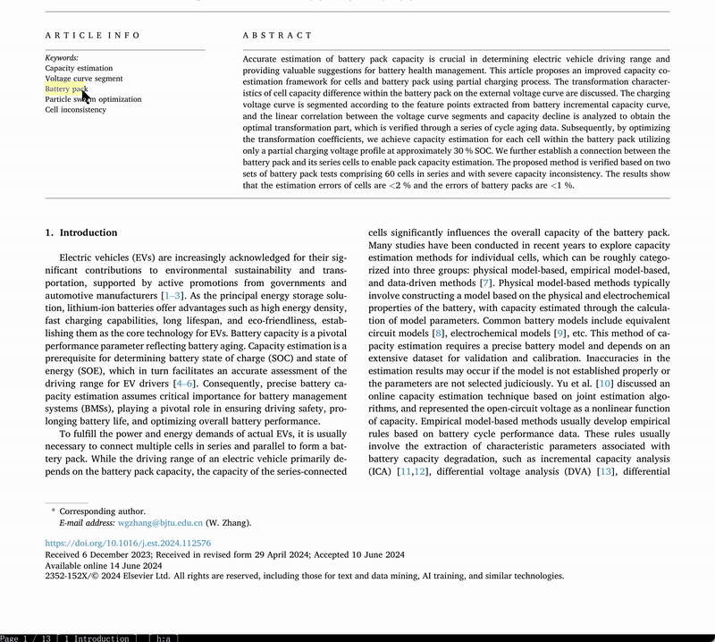
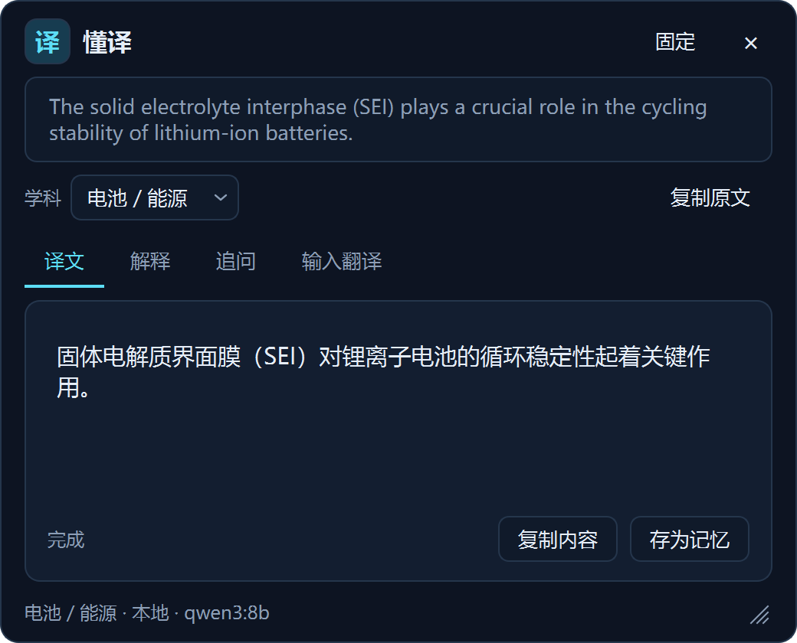
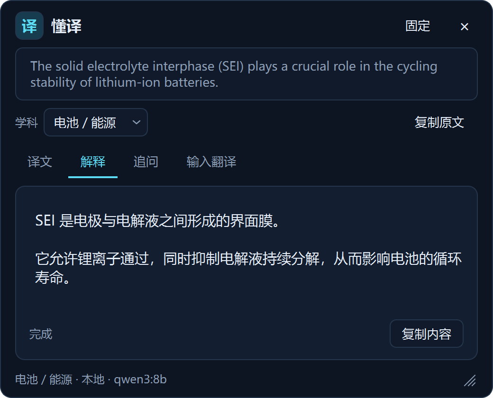
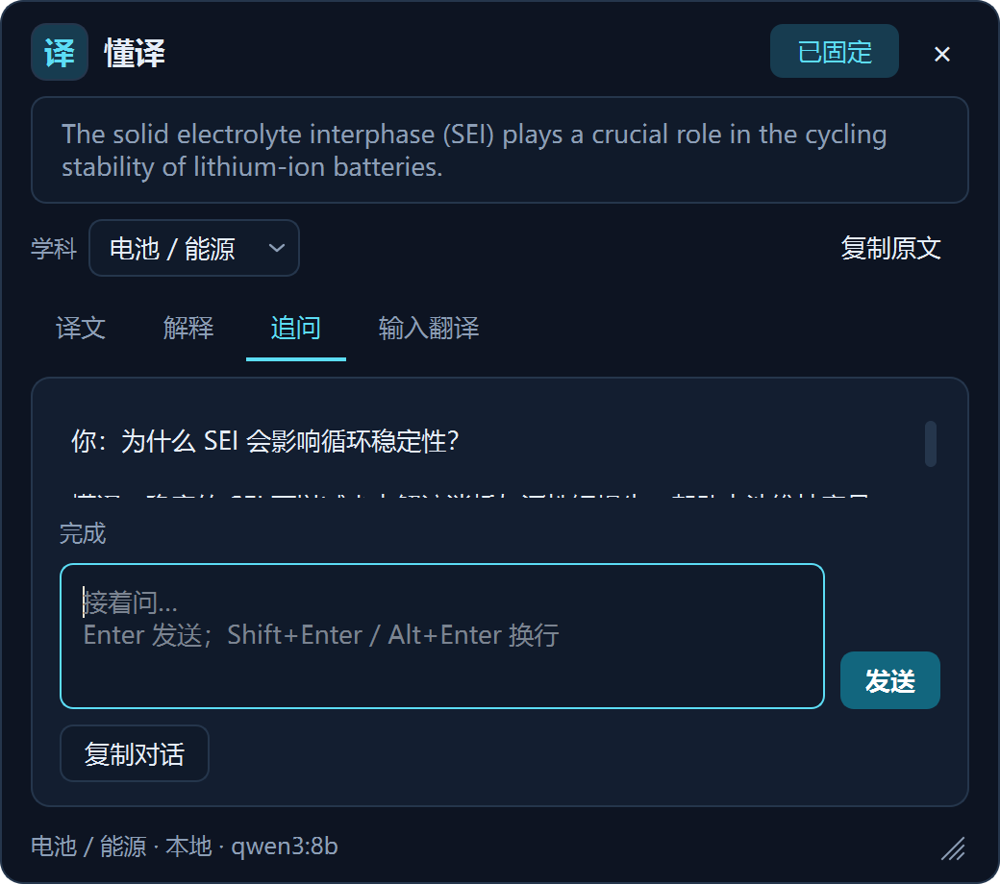
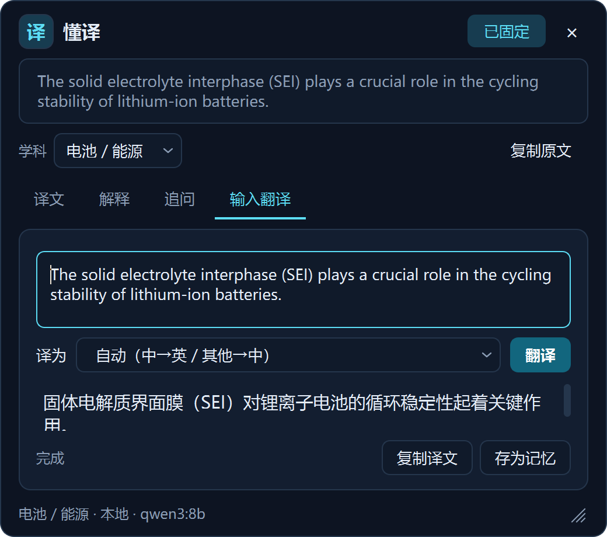

<div align="center">


# 懂译 · dongyi

**越来越懂你的翻译。**

**Windows 划词翻译工具，支持本地和云端模型；学科切换、强制术语表、个人知识库与翻译记忆，让它越用越懂你的专业领域。**

Domain-aware text-selection translation for Windows, powered by local Ollama or OpenAI-compatible APIs, with enforced glossaries, personal knowledge retrieval (RAG), and translation memory.

[](https://github.com/SyFu96/dongyi/actions/workflows/ci.yml)
[](https://github.com/SyFu96/dongyi/releases/latest)


[下载 Windows 版](https://github.com/SyFu96/dongyi/releases/latest) · [快速开始](#快速开始) · [领域适配](docs/DOMAINS.md) · [反馈问题](https://github.com/SyFu96/dongyi/issues)



*10 秒演示：划选 Battery pack → 学科「电池/能源」强制术语译文 → 一键解释。*

</div>

> 当前发布包 v0.1.0 为改名前的历史版本，尚不包含领域适配；体验下文的新功能请先[从源码运行](#从源码运行)。

在支持取词的应用中选中文字，点击选区旁的「译」，即可查看译文；还可以解释术语、继续追问。

> 使用云端模型时，当前文本会发送给对应服务商；云端追问还会携带原文、已有译文或解释及最近对话。
> 联网检索默认向 Ollama 搜索服务发送**解释的原文或本轮问题**。需要离线使用时，请按
> [配置说明](docs/CONFIG.md)启用「严格离线」，并关闭 Ollama 云功能。

## 功能

- **划词翻译**：选中文字后点击「译」，在弹窗中查看结果。
- **解释与追问**：解释当前文本，并围绕它继续提问。
- **输入翻译**：自己输入文本，选择目标语种翻译。
- **本地模型**：可连接本机 [Ollama](https://ollama.com/)；离线使用条件见[配置说明](docs/CONFIG.md)。
- **云端模型**：可接入支持流式 Chat Completions 的 OpenAI 兼容服务（DeepSeek、Qwen、GLM、Kimi 等）。
- **联网检索**：解释和追问可参考搜索结果；检索失败时使用模型自身知识。
- **学科切换**：在弹窗或托盘切换学科，也可自建领域，下一次请求即生效。
- **强制术语表**：命中的术语按指定译法翻译；CSV 修改后热更新，无需重启。
- **个人知识库（RAG）**：检索个人文献与笔记，支持 PDF、DOCX、Markdown、TXT 等；默认用于解释，可开启翻译检索。
- **翻译记忆**：点击「存为记忆」，校对后保存句对；以后翻译相似句子时自动作为参考。

领域设置、术语表与个人知识积累详见 [领域适配指南](docs/DOMAINS.md)。

## 界面预览

<div align="center">



深色科技风 · 电池 / 能源学科（示例数据）

</div>

| 术语解释 | 多轮追问 | 输入翻译 |
|---|---|---|
|  |  |  |

## 快速开始

### 直接下载（推荐）

到 [**Releases**](https://github.com/SyFu96/dongyi/releases) 下载 Windows x64 压缩包，**完整解压**后运行其中的 exe。当前发布包为历史版本 `huayi-v0.1.0-windows-x64.zip`，启动文件为 `huayi.exe`，尚不包含学科切换、术语表、个人知识库与翻译记忆；这些功能请先[从源码运行](#从源码运行)。打包版无需安装 Python；当前为公开测试版。

- 本地翻译：先装 [Ollama](https://ollama.com/)，再拉一个模型：

  ```powershell
  ollama pull qwen3-vl:8b-instruct          # 较小、较快
  # 或 ollama pull qwen3-vl:30b-a3b-instruct # 30B 版本，模型文件约 20GB；效果与速度取决于文本和硬件
  ```

  然后在「设置…」里把模型名改成对应名称。

- 云端翻译：托盘右键 →「设置…」，选「云端 API」，填地址 / 模型 / API Key。

### 从源码运行

需要 Windows、Git 和 [uv](https://docs.astral.sh/uv/)（自动管理 Python 3.13+）：

```powershell
git clone https://github.com/SyFu96/dongyi.git
cd dongyi
uv sync
uv run python app.py
```

## 怎么用

| 操作 | 说明 |
|---|---|
| 拖选文字 / 双击选词 | 选区旁浮出「译」，点它出译文 |
| `Ctrl+Alt+Shift+T` / `E` | 不拖选也能取当前选中文字，直接出「译文」/「解释」 |
| `Ctrl+Alt+Shift+I` | 呼出「输入翻译」，自己打字翻译 |
| 弹窗里的「解释」「追问」「输入翻译」 | 同一窗口里的另外三个标签 |
| 弹窗「学科」/ 托盘「学科」 | 切换专业领域，下一次请求生效 |
| 「存为记忆」 | 校对译文后保存，供相似句翻译参考 |
| 托盘右键 | 设置、学科、暂停监听、联网查询、开机自启动、退出 |

程序启动后安静地在后台运行（托盘图标）。改模型、填 API、开联网或严格离线，都在**托盘右键 →「设置…」**里。
更多操作（固定窗口、停止生成、追问换行、输入翻译快捷键等）见 [docs/USAGE.md](docs/USAGE.md)。

## 配置

首次运行自动生成 `config.json`（打包版写在 `%APPDATA%\dongyi\`）。字段说明见
[`config.example.json`](config.example.json) 和 [docs/CONFIG.md](docs/CONFIG.md)。

## 文档

- 详细用法 → [docs/USAGE.md](docs/USAGE.md)
- 配置字段与模型 / 联网 / 离线 → [docs/CONFIG.md](docs/CONFIG.md)
- 领域适配与个人知识库 → [docs/DOMAINS.md](docs/DOMAINS.md)
- 排错与已知限制 → [docs/TROUBLESHOOTING.md](docs/TROUBLESHOOTING.md)
- 开发、测试、打包 → [docs/DEVELOPMENT.md](docs/DEVELOPMENT.md)

## 许可

[GPL-3.0-only](LICENSE)。第三方组件许可与分发注意事项见 [THIRD_PARTY_NOTICES.md](THIRD_PARTY_NOTICES.md)。
