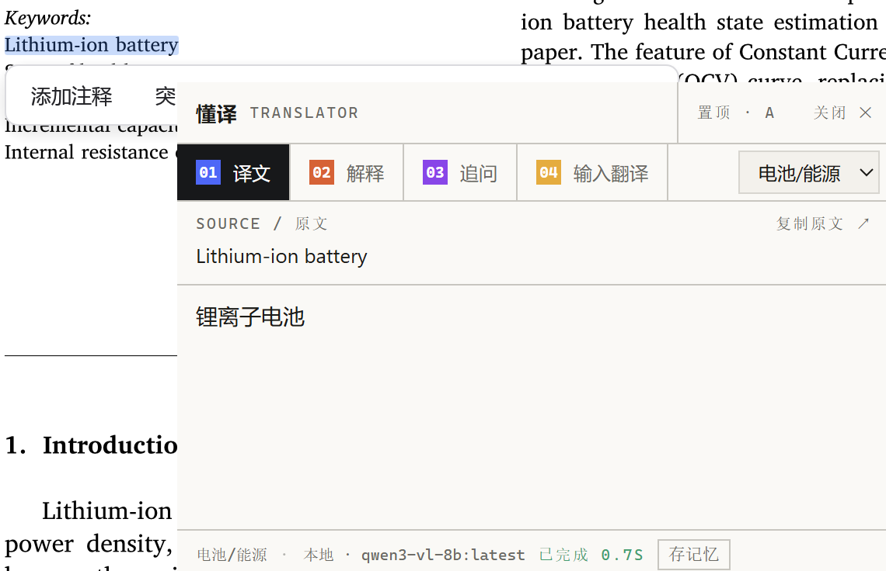
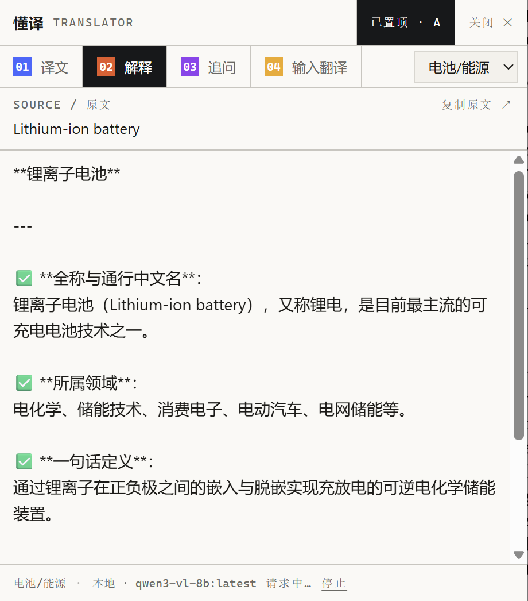
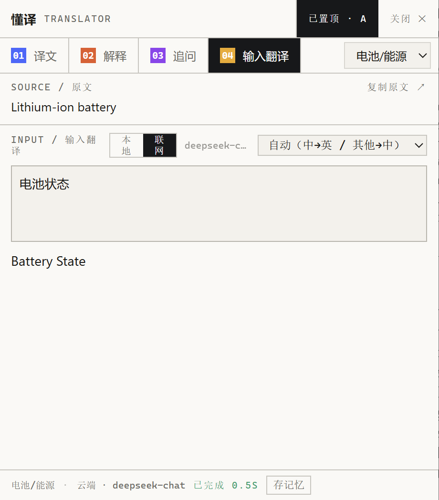
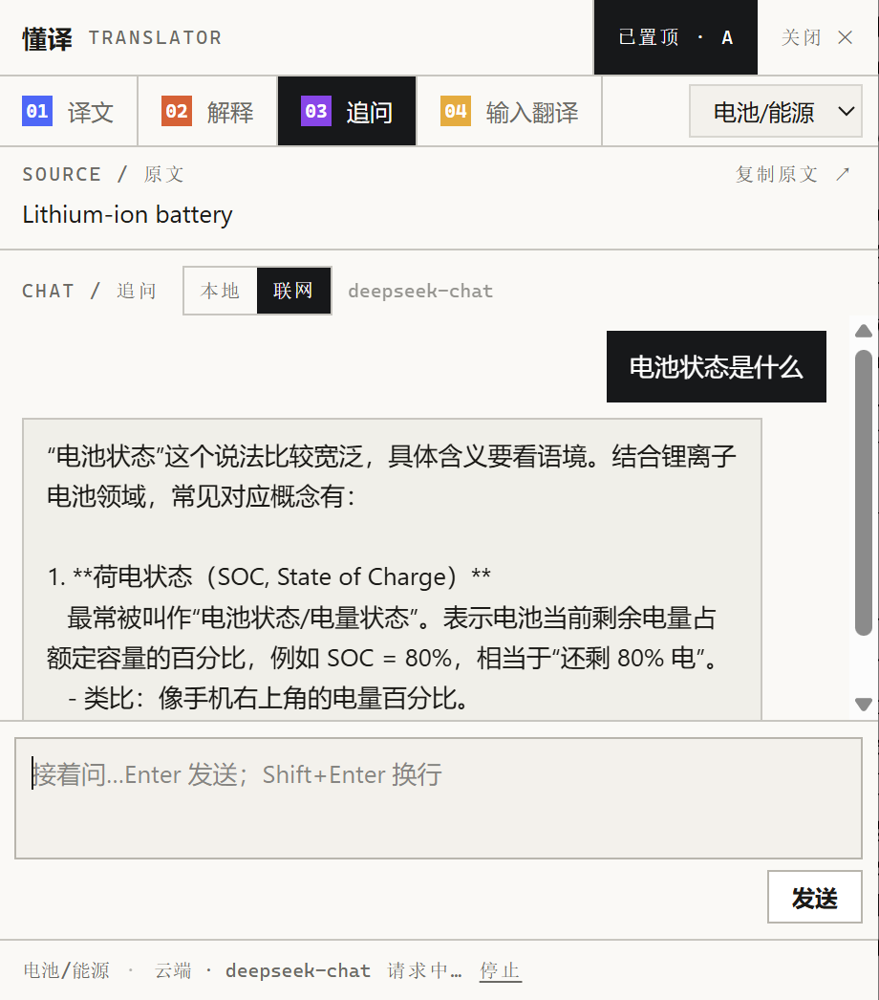

# 懂译 · dongyi（Rust / Tauri 版）

**越来越懂你的翻译。**

**Windows 划词翻译工具（Rust / Tauri 版）：选取文字即可翻译、解释、追问；支持本地和云端模型，学科切换、强制术语表、个人知识库与翻译记忆，越用越懂你的专业领域。**

Domain-aware text-selection translation for Windows, powered by local Ollama or OpenAI-compatible APIs, with enforced glossaries, personal knowledge retrieval (RAG), and translation memory.

[](https://github.com/SyFu96/dongyi/actions/workflows/ci-rust.yml)
[](https://github.com/SyFu96/dongyi/releases/tag/rust-v0.1.0)


[下载 Windows 版](https://github.com/SyFu96/dongyi/releases/tag/rust-v0.1.0) · [快速开始](#快速开始) · [领域适配](../docs/DOMAINS.md) · [反馈问题](https://github.com/SyFu96/dongyi/issues)

## 功能

- **划词翻译**：选中文字后点击「译」，在弹窗中查看结果。
- **热键取词**：`Ctrl+Alt+Shift+T / E / I` 在不拖选时取当前选中文字或呼出输入翻译。
- **解释与追问**：解释当前文本，并围绕它继续提问；回答支持 Markdown 排版，宽表格和代码块可横向滚动，支持复制原始回答。
- **输入翻译**：自己输入文本，选择目标语种翻译（可选本地或云端）。
- **本地模型**：可连接本机 [Ollama](https://ollama.com/)；离线使用条件见[配置说明](../docs/CONFIG.md)。
- **云端模型**：可接入支持流式 Chat Completions 的 OpenAI 兼容服务（DeepSeek、Qwen、GLM、Kimi 等）。
- **联网检索**：解释、追问及可选的输入翻译可先搜索资料，再由所选模型回答；可使用本地模型加搜索，无需云端模型 key。搜索总开关和各功能开关独立，输入翻译默认不搜索；搜索使用独立的 Ollama 搜索 key。
- **学科切换**：在弹窗或托盘切换学科，也可自建领域，下一次请求即生效。
- **强制术语表**：命中的术语按指定译法翻译；CSV 修改后热更新，无需重启。
- **个人知识库（RAG）**：检索个人文献与笔记（Markdown、TXT、CSV、JSON 等）；默认用于解释，可开启翻译检索。
- **翻译记忆**：点击「存为记忆」，校对后保存句对；以后翻译相似句子时自动作为参考。
- **双主题界面**：深色 / 浅色，可跟随系统切换。

## 取词方式与限制

拖选取词基于 UI Automation，在多数现代应用（浏览器、Office、编辑器等）可用；少数自绘界面应用读不到选区。
取不到时可按[配置说明](../docs/CONFIG.md)为特定阅读器开启受控的剪贴板兜底；此时用热键取词始终可用。
不承诺所有应用都出现浮标。

领域设置、术语表与个人知识积累详见[领域适配指南](../docs/DOMAINS.md)。

## 界面

| 译文 | 解释 |
|---|---|
|  |  |

| 输入翻译 | 追问 |
|---|---|
|  |  |

## 快速开始

### 直接下载（推荐）

到 [**Releases**](https://github.com/SyFu96/dongyi/releases/tag/rust-v0.1.0) 下载安装包
`dongyi_0.1.0_x64-setup.exe`，或绿色版 `dongyi_0.1.0_x64-portable.zip`（解压后运行 `dongyi.exe`）。
安装版为当前用户安装，无需管理员权限。

- 本地翻译：先装 [Ollama](https://ollama.com/)，再拉一个模型：

  ```powershell
  ollama pull qwen3-vl:8b-instruct          # 较小、较快
  # 或 ollama pull qwen3-vl:30b-a3b-instruct # 30B 版本，模型文件约 20GB；效果与速度取决于文本和硬件
  ```

  然后在「设置…」里把模型名改成对应名称（下拉可直接选择本机已有模型）。
- 云端翻译：托盘右键 →「设置…」，选「云端 API」，填地址 / 模型 / API Key。

### 从源码运行

需要 Windows、[Rust](https://rustup.rs/)（MSVC 工具链）、Node 20+：

```powershell
git clone https://github.com/SyFu96/dongyi.git
cd dongyi/dongyi-rs
npm install
npx tauri dev        # 桌面调试（前端热更）
npx tauri build      # 打包（安装包 + 绿色版）
```

## 怎么用

| 操作 | 说明 |
|---|---|
| 拖选文字 / 双击选词 | 选区旁浮出「译」，点它出译文 |
| `Ctrl+Alt+Shift+T` / `E` | 不拖选也能取当前选中文字，直接出「译文」/「解释」 |
| `Ctrl+Alt+Shift+I` | 呼出「输入翻译」，自己打字翻译 |
| 弹窗里的「解释」「追问」「输入翻译」 | 同一窗口里的另外三个标签 |
| 弹窗「学科」 | 切换专业领域，下一次请求生效 |
| 「存为记忆」 | 校对译文后保存，供相似句翻译参考 |
| 托盘右键 | 设置、退出 |

程序启动后安静地在后台运行（托盘图标）。改模型、填 API、开联网或严格离线，都在**托盘右键 →「设置…」**里：
模型 / 划词 / 热键 / 检索 / 外观（跟随系统主题）/ 领域 六组。

## 数据目录

`%APPDATA%\dongyi\`（与 Python 原版共用，可直接接力）：

| 路径 | 内容 |
|---|---|
| `config.json` | 全部配置（模型、热键、学科领域、知识库目录、主题等） |
| `app.log` | 运行日志（启动耗时、知识库刷新、模型请求等） |
| `glossaries\*.csv` | 术语表，每行 `原文,译文[,备注]`，`#` 开头为注释 |
| `tm\general.jsonl`、`tm\dom_<学科>.jsonl` | 翻译记忆（`{"src","tgt","time"}` 每行一条） |
| `kb_index\index.json` | 知识库索引 |

## 文档

- 详细用法 → [docs/USAGE.md](../docs/USAGE.md)
- 配置字段与模型 / 联网 / 离线 → [docs/CONFIG.md](../docs/CONFIG.md)
- 领域适配与个人知识库 → [docs/DOMAINS.md](../docs/DOMAINS.md)
- 排错 → [docs/TROUBLESHOOTING.md](../docs/TROUBLESHOOTING.md)
- Python 原版说明 → [PYTHON_VERSION.md](../PYTHON_VERSION.md)

## 许可

[GPL-3.0-only](../LICENSE)。第三方组件许可见 [THIRD_PARTY_NOTICES.md](THIRD_PARTY_NOTICES.md)
与 [THIRD_PARTY_LICENSES.txt](THIRD_PARTY_LICENSES.txt)。
